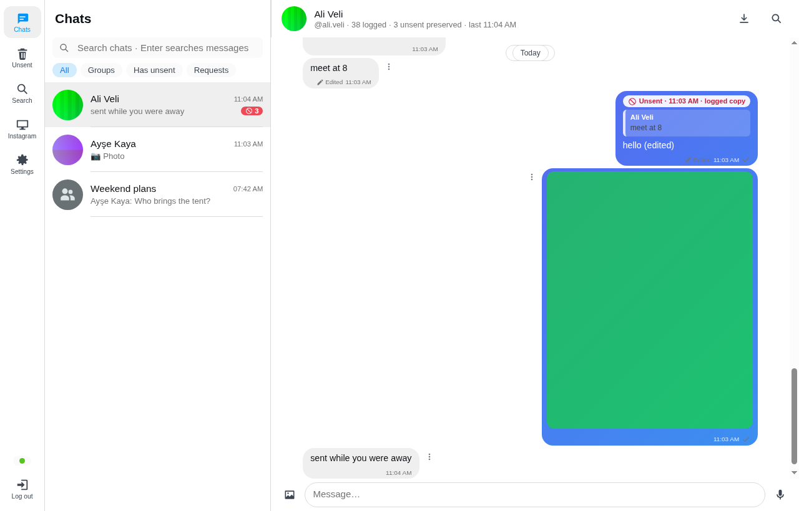
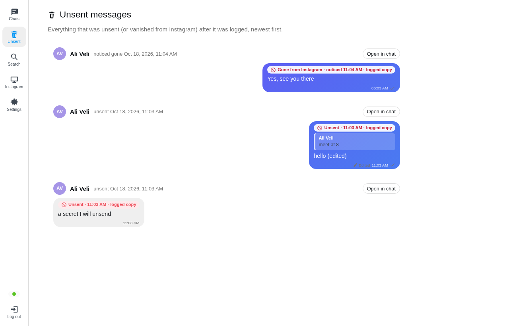
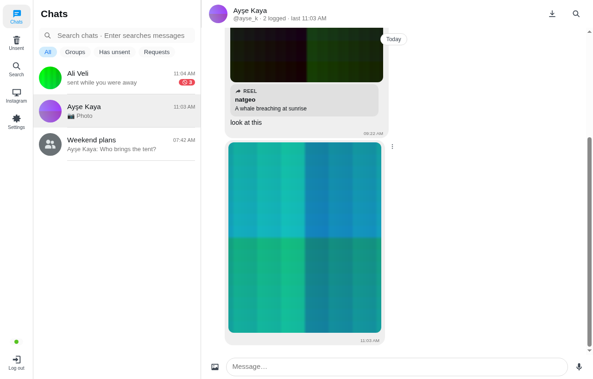
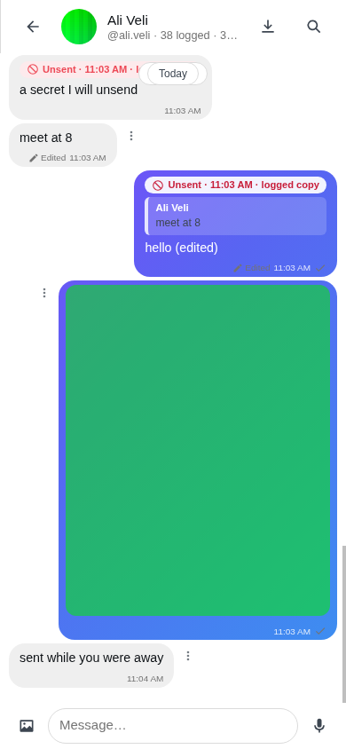

# insta_logger

Self-hosted, **encrypted Instagram direct-message logger** with an Instagram-like web UI — the Instagram sibling of
[wa_logger](https://github.com/revocx35/wa_logger).

insta_logger runs the real Instagram website inside a sandboxed Chromium container on your own server, records every
direct message, photo, video, voice message, shared post/reel, sticker, edit and reaction your account sends or
receives, and keeps it **even after the sender unsends it**. You read everything in an Instagram-style web interface,
and you can **send** from it too: text, replies, photos/videos, voice messages, reactions, edits and unsend. The live
Instagram session is one click away in the menu (**Instagram**), which is also where you log in.

<p>
  
  
</p>
<p>
  
  
</p>

_(Screenshots show test data from the built-in fake Instagram.)_

## Features

- **Anti-unsend:** messages the sender unsends stay readable and are flagged in red. Messages that disappear while
  insta_logger was offline are noticed by the next re-check and flagged as "gone from Instagram". The **Unsent** page
  lists all of them.
- **Edit history:** every earlier version of an edited message is kept.
- **Everything in DMs:** text, photos, videos, albums (each photo/video kept), voice messages, GIFs, stickers, shared
  posts/reels/stories/profiles/links (with their preview image and caption), music, replies, reactions, forwards,
  group events, disappearing-message timers and "Seen" for your own messages.
- **Media is downloaded immediately** by the browser container and stored encrypted, before it can be unsent or
  expire. Playback supports seeking (HTTP Range); several photos/videos can be downloaded as one ZIP.
- **Send messages** as your account: text, replies, photos/videos/audio, voice messages (needs HTTPS for the
  microphone), reactions, editing your text messages and unsending. Everything you send is logged like any other
  message. "Seen" is off unless you turn it on (Settings → Logging); replying in a chat marks it seen, as in Instagram.
- **History import** on first login (newest `HISTORY_PER_CHAT` messages per chat, default 100), paced so the account
  looks like a person using Instagram Web.
- **Search** across all decrypted messages, globally or per chat; **live updates**, light and dark themes, mobile layout.

**View-once (and "allow replay") photos and videos are not logged, by design** — same as wa_logger. They appear only
as a placeholder. Calls are not part of insta_logger.

## How it works (short)

The Chromium container keeps one Instagram Web tab on the inbox. Instagram Web receives every change to your inbox over
its own WebSocket (`gateway.instagram.com/ws/lightspeed`); insta_logger reads those frames **passively** over the
DevTools protocol and decodes them (DGW frames → protobuf → Instagram's "Slide" deltas: new message, unsend, edit,
reaction, read receipt, …). History, re-checks and sending use the same GraphQL requests Instagram Web itself makes,
run *inside* the tab with its own cookies and tokens. Media is fetched by the browser and streamed, encrypted, to disk.
The app container itself has no internet access. Details: [ARCHITECTURE.md](ARCHITECTURE.md),
[docs/instagram-notes.md](docs/instagram-notes.md).

## Security at a glance

Same design as wa_logger. See [SECURITY.md](SECURITY.md) and [ARCHITECTURE.md](ARCHITECTURE.md).

- **Encryption at rest with your password.** Message text, names, usernames, shared-post details and every media file
  are encrypted (AES-256-GCM) under data keys wrapped to an X25519 key pair whose private key is encrypted with your
  password (scrypt). The logger can *write* while you are logged out, but a stolen database, media folder or backup
  **cannot be read** without your password or recovery key. Instagram's signed media links are kept in memory only.
- **Single owner.** Signup needs the one-time `SETUP_TOKEN` from `.env` and closes after the first account. Optional
  **TOTP 2FA**, a recovery key, per-IP and per-account lockout, rate limits and an audit log.
- **Hardened sessions.** `__Host-` cookies (`Secure`, `HttpOnly`, `SameSite=Strict`), Origin + CSRF-token checks, idle
  and absolute expiry, session list and "log out everywhere".
- **Strict CSP** (no inline scripts, no third-party resources). Message content is never rendered as HTML; links are
  `noopener noreferrer nofollow` and are never fetched by the server.
- **Isolated containers.** The app container has **no internet access**. Only Chromium talks to Instagram; its DevTools
  and VNC ports exist only on an internal Docker network. Chromium keeps its **sandbox on** (custom seccomp profile)
  and a policy blocks every site except Instagram and the Meta domains its login and media use, plus downloads,
  uploads dialogs and extensions. All containers run non-root with read-only root filesystems, `cap_drop: ALL` and
  `no-new-privileges`.

> ⚠️ insta_logger drives the Instagram website with an automated browser. That may break Instagram's Terms of Use and
> could get the account restricted or asked for extra checks. It is built to behave like one person with Instagram Web
> open (one tab, paced requests, no bulk actions), but use it only for your own account and at your own risk. Laws
> about recording communications differ by country.

## Requirements

- Linux host with **Docker Engine 24+** and the **compose plugin** (v2).
- 2 GB RAM minimum (**4 GB recommended**). Chromium with Instagram uses about 0.5–1 GB.
- x86_64 (arm64 should work but is untested).
- Proxmox/LXC works. The container needs `nesting=1` (and `keyctl=1` if unprivileged) so Docker can run inside it.

## Install (Docker Compose)

Both ways give you the same three containers (`caddy`, `app`, `chromium`) and the same security settings.

### Option A: prebuilt images (no clone, no build)

CI publishes `ghcr.io/revocx35/insta_logger-app`, `…-chromium` and `…-caddy` (tags `latest`, `x.y.z`, `sha-…`).

```bash
mkdir insta_logger && cd insta_logger
curl -fsSLO https://raw.githubusercontent.com/revocx35/insta_logger/main/deploy/docker-compose.yml
curl -fsSLO https://raw.githubusercontent.com/revocx35/insta_logger/main/chromium/seccomp-chromium.json
curl -fsSLO https://raw.githubusercontent.com/revocx35/insta_logger/main/scripts/setup.sh
bash setup.sh --site 192.168.1.50     # your server's IP or domain; writes .env with random secrets
docker compose up -d
```

Update with `docker compose pull && docker compose up -d`. Pin a release with `IGL_VERSION=x.y.z` in `.env`.

<details>
<summary><b>The <code>docker-compose.yml</code></b> (same as <a href="deploy/docker-compose.yml">deploy/docker-compose.yml</a>)</summary>

```yaml
# insta_logger — standalone deployment with prebuilt images (no git clone, no build).
#
#   mkdir insta_logger && cd insta_logger
#   curl -fsSLO https://raw.githubusercontent.com/revocx35/insta_logger/main/deploy/docker-compose.yml
#   curl -fsSLO https://raw.githubusercontent.com/revocx35/insta_logger/main/chromium/seccomp-chromium.json
#   curl -fsSLO https://raw.githubusercontent.com/revocx35/insta_logger/main/scripts/setup.sh
#   bash setup.sh --site 192.168.1.50        # writes .env with random secrets (see README)
#   docker compose up -d
#
# Services:
#   caddy    : TLS termination, the only service with published ports
#   app      : Node supervisor + gateway + one worker per user (no internet access: internal networks only)
#   chromium : Instagram Web in a sandboxed, policy-locked Chromium, one browser per user (the only service that
#              talks to Instagram)
# Pin a release with IGL_VERSION=x.y.z in .env (default: latest).

name: insta_logger

x-logging: &logging
  driver: json-file
  options:
    max-size: "10m"
    max-file: "3"

x-hardening: &hardening
  read_only: true
  cap_drop: [ALL]
  security_opt:
    - no-new-privileges:true
  logging: *logging

services:
  caddy:
    image: ghcr.io/revocx35/insta_logger-caddy:${IGL_VERSION:-latest}
    restart: unless-stopped
    <<: *hardening
    cap_add: [NET_BIND_SERVICE]
    ports:
      - "${HTTP_BIND:-0.0.0.0}:${HTTP_PORT:-80}:80"
      - "${HTTPS_BIND:-0.0.0.0}:${HTTPS_PORT:-443}:443"
      # Extra ports for users the admin keeps off the default port (user management). Closed to the network by default:
      # set EXTRA_BIND=0.0.0.0 (or your LAN address) when the reverse proxy for those users runs on another host.
      - "${EXTRA_BIND:-127.0.0.1}:${EXTRA_PORTS:-8101-8110}:${EXTRA_PORTS:-8101-8110}"
    # Caddyfile = HTTPS (Let's Encrypt / internal CA); Caddyfile.http = plain HTTP behind your own TLS proxy.
    command: ["caddy", "run", "--config", "/etc/caddy/${CADDY_CONFIG:-Caddyfile}", "--adapter", "caddyfile"]
    environment:
      SITE_ADDRESS: ${SITE_ADDRESS:?create .env first (bash setup.sh)}
      CADDY_TLS: ${CADDY_TLS:-internal}
      CADDY_CONFIG: ${CADDY_CONFIG:-Caddyfile}
      EXTRA_PORTS: ${EXTRA_PORTS:-8101-8110}
    volumes:
      - caddy_data:/data
      - caddy_config:/config
    tmpfs:
      - /tmp:rw,noexec,nosuid,nodev,size=16m
    networks: [public, edge]
    depends_on:
      app:
        condition: service_healthy
    mem_limit: 256m
    pids_limit: 128

  app:
    image: ghcr.io/revocx35/insta_logger-app:${IGL_VERSION:-latest}
    restart: unless-stopped
    <<: *hardening
    # The supervisor (PID 1's child) starts the gateway and one worker per user under their own unix users: it needs
    # exactly these capabilities (KILL: to stop a worker that runs as another user), everything else stays dropped. The
    # processes it starts hold none.
    cap_add: [SETUID, SETGID, CHOWN, KILL]
    env_file:
      - .env
    environment:
      DATA_DIR: /data
      USERS_DIR: /users
      PORT: "8080"
      HOST: 0.0.0.0
      CHROMIUM_URL: http://chromium:9223
      # Shared with the chromium container only; the supervisor derives each user's browser token from it. (Releases
      # before user management used VNC_PASSWORD for the VNC server: it is the fallback so existing .env files work.)
      CONTROL_SECRET: ${CONTROL_SECRET:-${VNC_PASSWORD:-}}
      EXTRA_PORTS: ${EXTRA_PORTS:-8101-8110}
      # 1 = only the bundled Caddy; 2 = Caddy + your own reverse proxy in front (HTTP mode).
      TRUST_PROXY: ${TRUST_PROXY:-1}
    volumes:
      - app_data:/data
      - app_users:/users
    tmpfs:
      - /tmp:rw,noexec,nosuid,nodev,size:64m
      # Control socket and one socket directory per user worker.
      - /run/igl:rw,noexec,nosuid,nodev,size:4m,mode:0711
    networks: [edge, backend]
    depends_on:
      chromium:
        condition: service_healthy
    # One Node worker per user (about 200 MB each, more while they download media).
    mem_limit: ${APP_MEM_LIMIT:-2g}
    pids_limit: 1024

  chromium:
    image: ghcr.io/revocx35/insta_logger-chromium:${IGL_VERSION:-latest}
    restart: unless-stopped
    read_only: true
    cap_drop: [ALL]
    # The manager (root) starts every user's browser under that user's own unix user and stops it again: only these four
    # are needed (KILL: to signal a browser that runs as another user).
    cap_add: [SETUID, SETGID, CHOWN, KILL]
    security_opt:
      - no-new-privileges:true
      # Docker's default profile + the syscalls Chromium's namespace sandbox needs (sandbox stays ON).
      # Download it next to this file (see the header).
      - seccomp=./seccomp-chromium.json
    logging: *logging
    environment:
      CONTROL_SECRET: ${CONTROL_SECRET:-${VNC_PASSWORD:-}}
      MAX_INSTANCES: ${MAX_USERS:-10}
      SCREEN: ${SCREEN:-1280x800x24}
      # The browser's time zone (Instagram compares it with your IP address's location).
      TZ: ${TZ:-UTC}
      BACKEND_PEER: app
    volumes:
      - chromium_profile:/data
    tmpfs:
      - /tmp:rw,nosuid,nodev,size:512m
      # One home directory per user below here (the manager creates them 0700 for the right unix user).
      - /home/chrome:rw,nosuid,nodev,size:512m,mode:0711
      # Per-user X authority cookie and VNC password.
      - /run/igl:rw,noexec,nosuid,nodev,size:8m,mode:0711
    shm_size: ${CHROMIUM_SHM:-2gb}
    networks: [backend, egress]
    # Every active user runs a Chromium of about 1.5 GB: raise this with MAX_USERS.
    mem_limit: ${CHROMIUM_MEM_LIMIT:-6g}
    pids_limit: 4096
    stop_grace_period: 20s


networks:
  public: {}
  edge:
    internal: true
  backend:
    internal: true
  egress: {}

volumes:
  app_data: {}
  # Every user but the first (the first account's data stays in app_data).
  app_users: {}
  chromium_profile: {}
  caddy_data: {}
  caddy_config: {}
```

</details>

### Option B: build from source

```bash
git clone https://github.com/revocx35/insta_logger.git
cd insta_logger
scripts/setup.sh --site 192.168.1.50
docker compose up -d --build
```

Update with `git pull && docker compose up -d --build`.

### Behind your own reverse proxy (plain HTTP)

If you already run a reverse proxy (Nginx Proxy Manager, Traefik, Caddy, Cloudflare Tunnel, …) that terminates
TLS, run insta_logger in HTTP mode and point the proxy at it:

```bash
bash setup.sh --site 192.168.1.50 --http-only      # or scripts/setup.sh … from a checkout
docker compose up -d
```

- **Proxy target:** `http://192.168.1.50:80`. Enable WebSocket support (needed for the Instagram view), and keep the
  default forwarded headers (`Host`, `X-Forwarded-For`, `X-Forwarded-Proto`).
- **Cookies:** `COOKIE_SECURE=auto` makes session cookies `Secure` (+ HSTS) whenever the proxy reports HTTPS. You
  can still open `http://192.168.1.50` directly on your LAN.
- **Client IPs:** `TRUST_PROXY=2` trusts X-Forwarded-For through your proxy and the bundled Caddy, so login
  throttling sees real client IPs. Forwarded headers are only accepted from private network addresses.
- **Origin:** once the public URL is final, you can pin it with `PUBLIC_ORIGIN=https://ig.example.com` in `.env`.
- **Exposure:** only your reverse proxy should reach port 80. Don't forward it to the internet directly.

### Optional: cap storage with a dedicated disk

Logged media can grow large. To give insta_logger a hard size limit, put its volumes on their own
filesystem (a separate disk, partition or LVM volume) and bind them with a `docker-compose.override.yml`
next to `docker-compose.yml`. Compose merges it automatically:

```bash
# example with LVM: 50% of the volume group's free space
lvcreate -n insta_logger -l 50%FREE ubuntu-vg && mkfs.ext4 -L insta_logger /dev/ubuntu-vg/insta_logger
mkdir -p /srv/insta_logger && echo "LABEL=insta_logger /srv/insta_logger ext4 defaults,noatime,nodev,nosuid 0 2" >> /etc/fstab && mount /srv/insta_logger
install -d -m 700 /srv/insta_logger/{app_data,chromium_profile,caddy_data,caddy_config}
chown 10001:10001 /srv/insta_logger/app_data && chown 10002:10002 /srv/insta_logger/chromium_profile
```

```yaml
# docker-compose.override.yml
volumes:
  app_data:         { driver: local, driver_opts: { type: none, o: bind, device: /srv/insta_logger/app_data } }
  chromium_profile: { driver: local, driver_opts: { type: none, o: bind, device: /srv/insta_logger/chromium_profile } }
  caddy_data:       { driver: local, driver_opts: { type: none, o: bind, device: /srv/insta_logger/caddy_data } }
  caddy_config:     { driver: local, driver_opts: { type: none, o: bind, device: /srv/insta_logger/caddy_config } }
```

The app pauses media downloads when that filesystem has less than 2 GB free, so the database always has room.

### `setup.sh` options

| Situation | Command |
|---|---|
| LAN / IP address (self-signed CA from Caddy) | `setup.sh --site 192.168.1.50` |
| Public domain with Let's Encrypt | `setup.sh --site ig.example.com --email you@example.com` |
| Behind your own TLS reverse proxy | `setup.sh --site 192.168.1.50 --http-only` |
| Other ports | `--https-port 8443 --http-port 8080` |

For a home setup, the safest option is to **keep it on your LAN or VPN** (WireGuard, Tailscale) and not expose it.

## Multiple users

insta_logger can serve a few people from one stack. The **first account is the admin**: its address (the default port)
can sit behind a login proxy such as authentik, and the admin hands each other person their own port and address.

1. As the admin, open **Users → Add a user**: username and (optionally) a temporary password. Pick a port (see below)
   or leave *Default*.
2. Give the person the temporary password (shown once) and the address of their port. They sign in there, are asked to
   **choose their own password** (their data is encrypted with a key only their password/recovery key can unwrap, so the
   admin never sees their messages), and log **their own** Instagram in on their own live screen.
3. Open the ports you want to use in **Users → Ports** (they come from `EXTRA_PORTS`, default `8101-8110`, published by
   the bundled Caddy). Point a reverse-proxy host at each port you open. Set that port's *address* so the browser origin
   is checked exactly (leave it empty to accept the address the proxy forwards).
4. If those ports are published on `EXTRA_BIND=0.0.0.0` (because your reverse proxy is on another host), firewall the
   range so only that proxy can reach it.

Each user has separate data, keys, database, unix user and Chromium. The admin sees names, status, ports and an admin
log — never messages. The admin can disable a user (their sessions end), move them to another port, reset their
password (they need their recovery key) or **wipe** their account (all data and the Instagram login are deleted), and
delete them. **The first account cannot be deleted.**

Sizing: each active user runs a Chromium of about 1.5 GB and a Node worker of about 200 MB. Raise `CHROMIUM_MEM_LIMIT`
(default 6g) and `APP_MEM_LIMIT` (default 2g) with `MAX_USERS`.

**Upgrading a single-user install:** replace the compose file with the new one (the app and chromium containers need
`cap_add: SETUID SETGID CHOWN KILL`, the app needs the `app_users` volume and the `/run/igl` tmpfs, caddy the
`EXTRA_PORTS` block), keep your `.env` (`CONTROL_SECRET` falls back to `VNC_PASSWORD`), then
`docker compose pull && docker compose up -d`. Your existing account is adopted as the admin; everybody signs in again.

## First run

1. Open the address `setup.sh` printed (e.g. `https://192.168.1.50`). With `internal` TLS your browser warns once; you
   can trust Caddy's root certificate: `docker compose cp caddy:/data/caddy/pki/authorities/local/root.crt ./caddy-root.crt`
2. **Sign up** with the *setup token* from `.env`, a username and a strong password (12+ characters).
3. **Save the recovery key.** It is shown once and is the only way back in if you forget your password.
4. **Log in to Instagram** on the page that follows: it shows the live Instagram website from the server's browser.
   Type your Instagram username and password there; answer a 2FA code or "was this you?" check there too (or approve
   it in the Instagram app).
5. When the status shows **Connected** (or **Importing history**), press **Complete**.

**Instagram keeps asking for a captcha?** Instagram's login can distrust a browser it has never seen on a server and
send it back to the captcha after every login. Then log in with your own browser instead (the panel *Captcha keeps
coming back?* on the same page):

1. On your computer, open a **private window**, go to instagram.com and log in.
2. Press **F12** → **Network**, reload the page, right-click the first request (`www.instagram.com`) → **Copy** →
   **Copy as cURL** (on Windows: *Copy as cURL (bash)*). A plain `Cookie:` header or a cookie-editor JSON export works too.
3. Paste it into the panel and press **Use this login**.
4. Close the private window **without logging out** (logging out ends that session everywhere).

insta_logger keeps only Instagram's own cookies from what you paste (`sessionid`, `ds_user_id`, `csrftoken`, `mid`,
`ig_did`, `datr`, …), puts them into its browser and never logs or stores them anywhere else.

From now on every new direct message is logged; the newest `HISTORY_PER_CHAT` messages of each chat are imported too.

## Android app

A native Android client for this server: [insta_logger_android](https://github.com/revocx35/insta_logger_android)
(signed APK on its Releases page). Chats with unsent copies, sending, the Instagram screen, settings and Reels — all
through your server, so the phone never talks to Instagram.

## Using it

| Menu | What it does |
|---|---|
| **Messages** | Instagram-style chat list (filters: groups, chats with unsent messages, message requests) and the chat view |
| **Unsent** | Every message that was unsent (or vanished) after it was logged, newest first, with a link into its chat |
| **Search** | Full-text search over decrypted messages and shared posts |
| **Stories** | Logged stories of the accounts you follow (turn on in Settings → Logging, choose how many days to keep them): grid per account, full-screen viewer, *Check now*. Never marked as seen |
| **Reels** | Instagram's reels feed, played through the server (Instagram only sees the server). Like (also double-click), read comments, comment and reply; **Send** shares a reel into your chats as its link |
| **Instagram** *(under More on phones)* | Live view of the background Instagram tab (view-only toggle, reload, log out) — log in here when needed |
| **Settings** | Password, 2FA, recovery key, sessions, logging options, background session refresh (every N hours ± up to 10 min, random), security log, wipe data |

Unsent messages have a **red frame** and the time they were unsent. Edited messages show an **Edited** link with the
edit history. Media that could not be downloaded shows the reason and a **Retry** button.

## What gets logged, and the limits

- Messages are captured **while the stack runs and Instagram is logged in**. After downtime, a re-check (on reconnect
  and every `RECONCILE_MINUTES`) re-reads the newest messages of chats that moved: it logs what was missed and flags
  logged messages that are gone (unsent meanwhile).
- A message unsent **before** insta_logger saw it cannot be recovered.
- Media larger than `MEDIA_MAX_MB` (default 100) is not downloaded automatically; it can be retried while Instagram
  still has it. Instagram's media links expire after some days, so old history media may be unavailable.
- View-once media is never logged. Calls aren't supported.
- Leave the Instagram tab on the inbox: an open conversation sends "Seen" for new messages. insta_logger returns the
  tab to the inbox after two minutes elsewhere.
- If Instagram logs the browser out or asks for a check, a banner appears; fix it on the **Instagram** page.
- Instagram changes its website often. insta_logger learns Instagram Web's current GraphQL document ids from the tab's
  own requests, but a bigger change can still break history import or sending until insta_logger is updated; the live
  log keeps working as long as the message stream format holds.

## Operations

```bash
docker compose ps                 # health
docker compose logs -f app        # app logs (never contain message content, names or tokens)
docker compose pull && docker compose up -d   # update (from source: git pull && docker compose up -d --build)
docker compose down               # stop (data stays in Docker volumes)
```

**Backups.** Back up the Docker volumes:

- `insta_logger_app_data`: the first account's database and media. **Encrypted**; useless without its password or recovery key.
- `insta_logger_app_users`: every other user's database and media (encrypted, same way) and the user list/ports.
- `insta_logger_chromium_profile`: **the live Instagram login.** Anyone holding it can use your Instagram account.
  Protect it like a password, or skip it and log in again after a restore.
- `.env`: secrets (setup token, `CONTROL_SECRET`).

**Reset / uninstall:** `docker compose down -v` deletes **everything**: logs, media and the Instagram login.

## Troubleshooting

| Symptom | Fix |
|---|---|
| Browser certificate warning | Expected with `CADDY_TLS=internal`; trust Caddy's root cert (see First run). |
| "Cross-origin request rejected" | Open exactly the `PUBLIC_ORIGIN` from `.env` (same scheme, host and port). |
| Chromium unhealthy, "No usable sandbox" | Docker ignores the seccomp profile, or user namespaces are disabled (`sysctl kernel.unprivileged_userns_clone=1`). Last resort only: `CHROMIUM_NO_SANDBOX=1`. |
| Status "Waiting for login" / "Needs confirmation" | Open **Instagram** in the menu, switch off "View only" and log in / answer the check. |
| Status stays "Connected" but nothing new is logged | Settings → Instagram shows the time of the last live update; **Reload Instagram** reconnects. `docker compose logs app` shows decoding problems (without content). |
| History import or sending fails after an Instagram update | Update insta_logger. The live log usually keeps working meanwhile. |
| Lost password | **Forgot your password?** on the login page, with your recovery key. |

## Development

```bash
cd server && PUPPETEER_SKIP_DOWNLOAD=true npm ci && npm test && npm run typecheck
cd web && npm ci && npm test && npm run build
scripts/smoke.sh                                   # full stack in an isolated compose project (23 checks, real instagram.com login page)
cd server && npx tsx ../scripts/dev/fake-e2e.mts   # full stack against a fake Instagram (61 checks: stories, login hands-off, pasted session, reels, stream, unsend, media, sending, reconcile)
```

Docs: [ARCHITECTURE.md](ARCHITECTURE.md) (design), [docs/instagram-notes.md](docs/instagram-notes.md) (Instagram Web
facts the code relies on), [SECURITY.md](SECURITY.md) (threat model), [AGENTS.md](AGENTS.md) (notes for AI agents).

The Instagram wire format was worked out with the help of the open-source
[mautrix-meta](https://github.com/mautrix/meta) bridge (AGPL; insta_logger reuses no code from it, only the documented
protocol facts).
